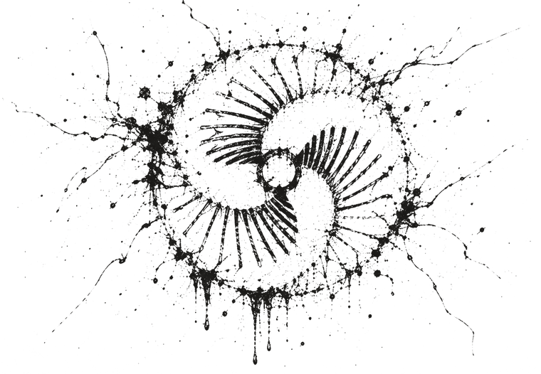
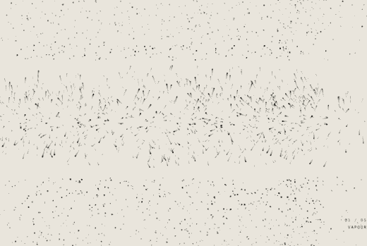
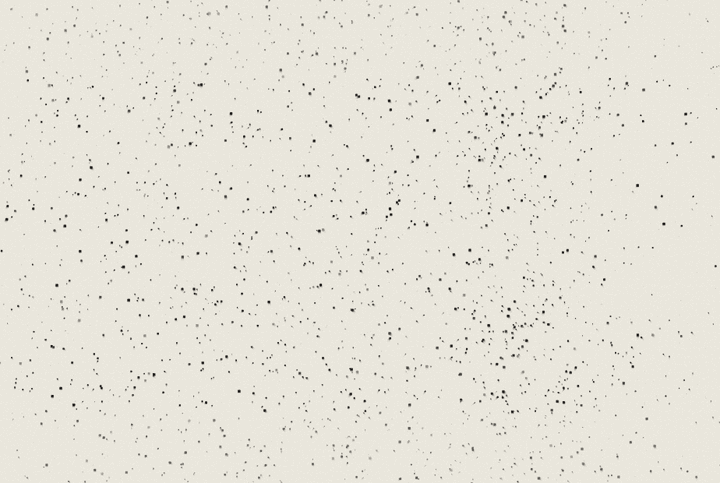
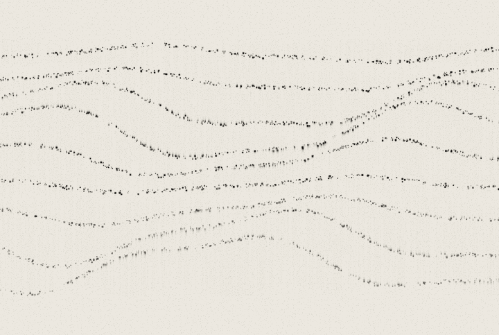
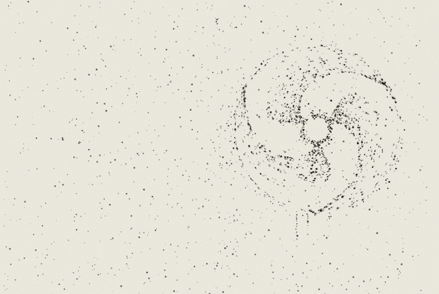

  

> **Being tested on hardware.** The [install page](https://de-pattern.github.io/viscera/) offers every published version (the newest first, with a line on each) for hardware testing, and says which one an FM-1 has when it connects, installed from M-VAVE's stock V15 (it refuses to install from Ravel or other Felucca-based firmware). Back up first. If the FM-1 stays dark afterwards, [Ravel's install page](https://de-pattern.github.io/Ravel_FM1/install/) "Back to the stock firmware" with a V15 file puts M-VAVE's firmware back. The `.fwsc` files on the releases page are older builds: please don't flash those. You can also try Viscera in the [browser emulator](https://de-pattern.github.io/viscera/emulator/).

<h1 align="center">viscera</h1>

4-TRACK: an overdubbing tape-looper firmware for the M-VAVE FM-1, in the spirit of a TASCAM Portastudio. 
<a href="https://de-pattern.github.io/viscera/">Install page</a> · <a href="https://de-pattern.github.io/viscera/manual.html">Guide</a> · <a href="docs/DESIGN.md">Design</a> · <a href="docs/STATUS.md">Status</a>

  

Viscera 4-Track records sound coming in over Bluetooth (a phone or tablet) or USB (a computer) onto four tracks of tape in the FM-1's memory, and overdubs them:

- **The tape**: four mono tracks of 4-bit ADPCM, at three tape speeds (2.8, 3.8 or 5.6 s a track). The first take sets the loop; then punch in and out of the armed tracks, DUB or REPLACE. SPEED is varispeed (pitch and time together, as tape); PITCH shifts the mix without changing its time.
- **The desk**: four channel strips with VU meters, each with a TRIM into a 424-style preamp (clean to 0 VU, then softly rounding with a little second harmonic), PAN and LEVEL; the input has its own preamp with DRIVE.
- **Bounce**: print any tracks, through RESON and a preamp, onto a free track, one loop long.
- **RESON**: an eight-band resonant filterbank (LIQUID, GLASS, THROAT, DUST, RADIO, DROPS) on a track, the input or a bounce.
- **Robots**: two, moving SPEED, PITCH, levels, pans or RESON as LFOs or as a recorded knob gesture, plus an eight-route LFO matrix: hold LFO and turn any knob to route a robot to it. MIDI learn for knobs and for REC, PLAY and the arm keys.

The screen is drawn as a tape machine: reels that wind with the loop, a mechanical counter, amber VU meters, aluminium knobs.

It's built on M-VAVE's official FM1 Open SDK (V14), so Bluetooth, USB audio and MIDI keep working.

**Status: being tested on hardware.** The firmware builds, packages, passes M-VAVE's updater checks and starts in an emulated FM-1 running M-VAVE's own library. 2.0 replaced the 1.x live-capture engine (PUTTY) with the 4-track; 1.x projects don't load, and 1.x is still on the install page.

| | |
|:-:|:-:|
|  |  |
| vapour | rain |
|  |  |
| swell | settle |

## Try it in the browser

The [emulator](https://de-pattern.github.io/viscera/emulator/) runs the firmware's own C core, compiled to WebAssembly: the engine, the screen and the controls, with an audio file, your computer's sound or your microphone standing in for Bluetooth and USB audio in.

## Install

Open the [install page](https://de-pattern.github.io/viscera/) in Chrome or Edge on a computer, with the FM-1 on and connected by USB. It uses M-VAVE's own update protocol. Back up your projects and samples with M-VAVE's workbench first; the workbench can also put the stock firmware back.

Each release is built in CI and goes straight to the install page. See [Releases](https://github.com/De-Pattern/viscera/releases) for the `.fwsc` files and [CHANGELOG.md](CHANGELOG.md) for what changed.

## Licence

GPL-3.0 with M-VAVE's FM1 SDK linking exception, as the SDK's app sources require. The SEA decoder table is MIT (Dani Biro, M-VAVE).
