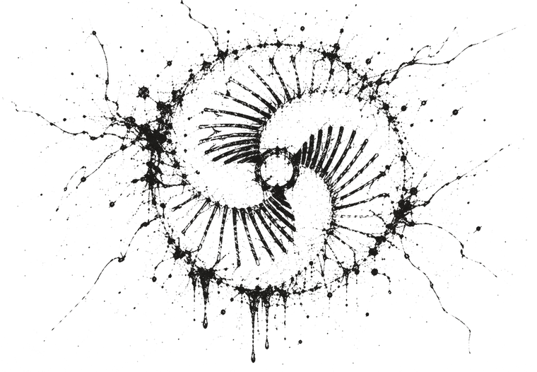
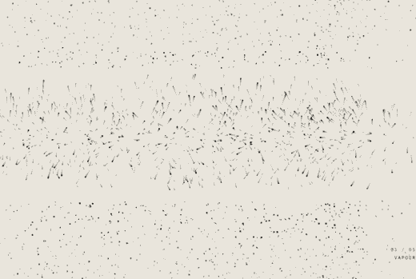
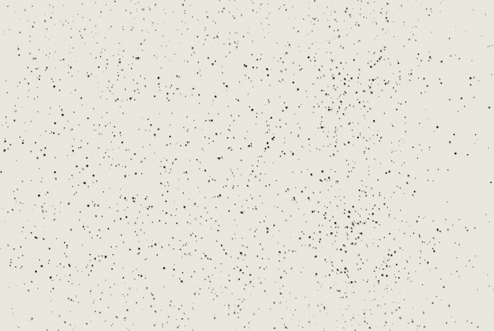
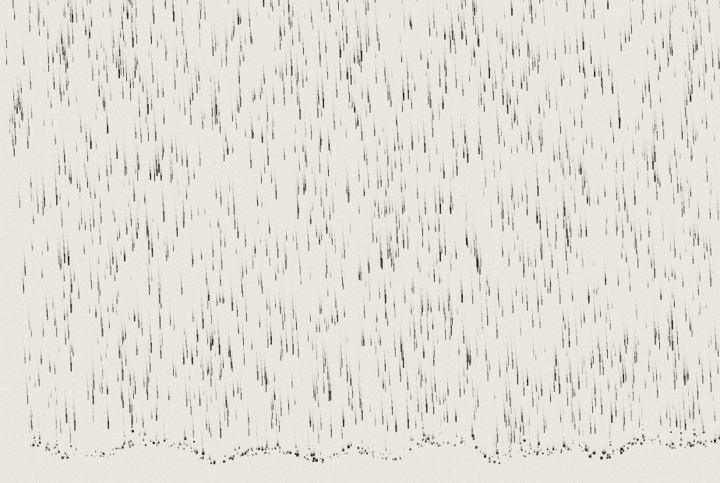
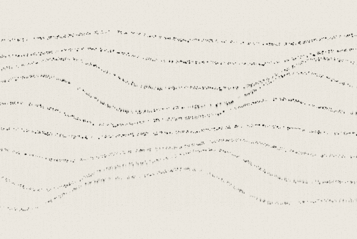
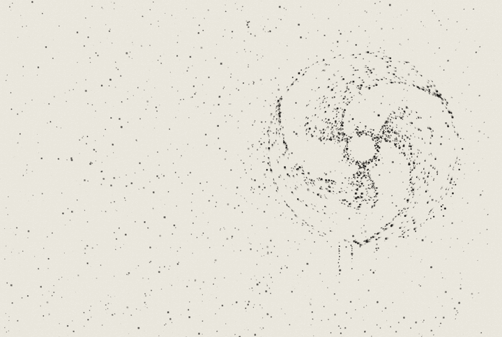

  

> **Being tested on hardware.** The [install page](https://de-pattern.github.io/viscera/) offers the latest build for hardware testing, installed from M-VAVE's stock V15 (it refuses to install from Ravel or other Felucca-based firmware). Back up first. If the FM-1 stays dark afterwards, [Ravel's install page](https://de-pattern.github.io/Ravel_FM1/install/) "Back to the stock firmware" with a V15 file puts M-VAVE's firmware back. The `.fwsc` files on the releases page are older builds: please don't flash those. You can also try Viscera in the [browser emulator](https://de-pattern.github.io/viscera/emulator/).

<h1 align="center">viscera</h1>

PUTTY: a live-capture firmware for the M-VAVE FM-1. Catch loops and work them like putty. 
<a href="https://de-pattern.github.io/viscera/">Install page</a> · <a href="docs/DESIGN.md">Design</a> · <a href="docs/STATUS.md">Status</a>

  

Viscera catches sound coming in over Bluetooth (a phone or tablet) or USB (a computer) and lets you work it like putty. Tap REC to catch a loop, tap again to end it; a partner track can catch what the first one plays, or the two can pass a sound back and forth. Then stretch it without changing its pitch, freeze it, phase-vocode it, break it into glass-shard grains and build it back up:

- **HANDS**: stretch (0.25× to 8×, frozen at the top) and pitch, independent of each other, over a window you move and size.
- **SHARDS**: up to eight grains with expodec, reverse-expodec and shattering windows, free, on the hits the listener hears, on notes or on the clock.
- **SPECTRA**: a phase vocoder: blur, shift, gate, hold, and CROSS, one track's spectrum on its partner's phases.

Four tracks in two pairs, each SOURCE → PUTTY → COLOR into a shared SPACE bus (delay and reverb), with four modulators per track, robots (a knob gesture recorded while REC is held, looping on its own), macros, scenes that morph, and STEPS (each step a SLICE, PITCH, LEN and PROB) or CAROM. Captures can be kept on a reel in flash.

It's built on M-VAVE's official FM1 Open SDK (V14), so Bluetooth, USB audio and MIDI keep working, and samples uploaded with M-VAVE's workbench still play.

**Status: being tested on hardware.** The firmware builds, packages, passes M-VAVE's updater checks and starts in an emulated FM-1 running M-VAVE's own library. 1.0 replaced 0.x's engine: 0.x projects don't load.

| | |
|:-:|:-:|
|  |  |
| vapour | rain |
|  |  |
| swell | settle |

## Try it in the browser

The [emulator](https://de-pattern.github.io/viscera/emulator/) runs the firmware's own C core, compiled to WebAssembly: the engine, the screen and the controls, with an audio file or your microphone standing in for Bluetooth and USB audio in.

## Install

Open the [install page](https://de-pattern.github.io/viscera/) in Chrome or Edge on a computer, with the FM-1 on and connected by USB. It uses M-VAVE's own update protocol. Back up your projects and samples with M-VAVE's workbench first; the workbench can also put the stock firmware back.

Each release is built in CI and goes straight to the install page. See [Releases](https://github.com/De-Pattern/viscera/releases) for the `.fwsc` files and [CHANGELOG.md](CHANGELOG.md) for what changed.

## Licence

GPL-3.0 with M-VAVE's FM1 SDK linking exception, as the SDK's app sources require. The SEA decoder table is MIT (Dani Biro, M-VAVE).
